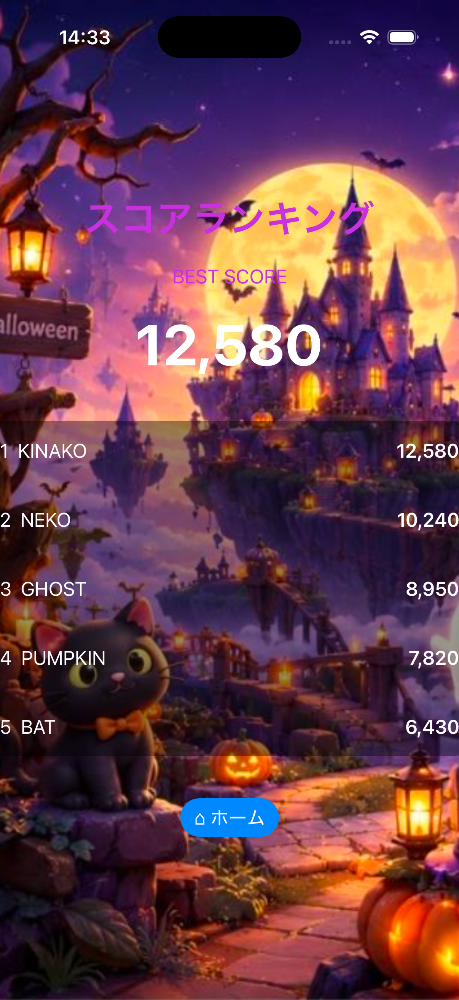

# 日専祭アプリ： ハロウィンマージ

> **チーム：** チーム名:猫のクボ太 氏名:26CM0110 窪田黄菜子、26CM0111 黒田貴子、26CM0112 伍夢露
> **AI利用レベル：** 2（生成コード可）
> **最終更新：** 2026-10-07

> 💡 制作の進め方は担任の先生から案内があります。このファイルの項目は、担任の先生の指示で増えることがあります。

> **チーム：** 猫のクボ太（26CM0110 窪田黄菜子、26CM0111 黒田貴子、26CM0112 伍夢露）
---

## 何ができるアプリか（3行）
パズルゲーム2048風のマージゲーム。
マス目上でタイルをスライドさせて同じアイテムを重ねると合体します。
ハロウィンの世界の中で遊べます。

（例：買い物リストを作るアプリ。品名を入力して追加できる。買ったものにチェックを付けると一覧から消える。）

## 画面
 

## 使った文法・技術

（例：`@State`、`List`、`ForEach`、構造体、配列の `append` と `remove`）

## 生成AIの使い方（どの場面で、どう使ったか）

（例：画面の骨組みは ChatGPT に書いてもらった。削除ボタンが効かなかったので、原因を質問して直した。）

## 展示で工夫した点

（例：文字を大きくして、来場者が操作しやすいようにした。）
